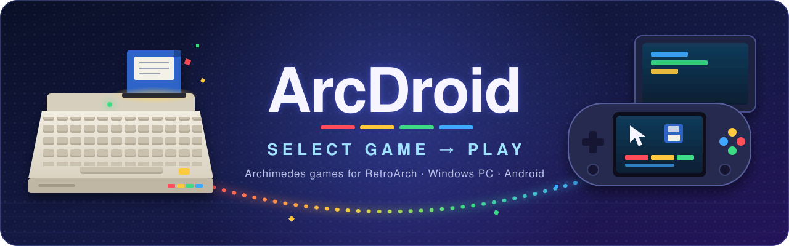
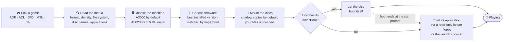
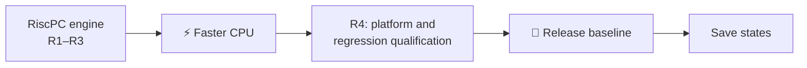

<!-- SPDX-License-Identifier: GPL-2.0-only -->

<p align="center">
  
</p>

<h1 align="center">ArcDroid</h1>

<p align="center">
  <b>Pick a game. Press play. ArcDroid sets up the Archimedes for you.</b><br>
  A RetroArch / libretro core that brings Acorn Archimedes games to Windows PCs and Android handhelds, so you never have to set up an Archimedes by hand.
</p>

<p align="center">
  <a href="https://github.com/sayenah/ArcDroid/actions/workflows/ci.yml"></a>
  <a href="COPYING"></a>
</p>

<p align="center">
  <sub>Windows x86_64 · Android arm64-v8a · libretro · in development, no release yet</sub>
</p>

<p align="center">
  <a href="#-how-it-works">How it works</a> ·
  <a href="#-features">Features</a> ·
  <a href="#-the-engineering-behind-it">Engineering</a> ·
  <a href="#-platforms">Platforms</a> ·
  <a href="#-whats-coming">What's coming</a> ·
  <a href="#-quick-start">Quick start</a> ·
  <a href="#-credits">Credits</a>
</p>

> [!NOTE]
> **ArcDroid is in active development and has no release yet.** Everything under *Features* is on `main` today, and you can build it yourself now. RiscPC support and save states are still being built; see [What's coming](#-whats-coming).

---

## ✨ How it works

Getting an Archimedes game running has usually meant choosing a machine, finding the right ROM, setting up CMOS, mounting the right disc, and knowing which file to double-click or which `*` command to type.

**ArcDroid does that work for you.** Load a disc image in RetroArch as you would load a cartridge on any other console. ArcDroid reads the media, sets up a suitable Archimedes, picks the best firmware you have installed, mounts the discs and takes the game through its boot.



ArcDroid types no commands into the emulated machine, and launching never changes the game disc. It starts games through RISC OS's own desktop boot path.

**One general emulator for every game.** ArcDroid has **no compatibility database, no per-title profiles and no game-specific patches**. Every game runs through the same general machine emulation, and rules taken from the structure of the media decide how it starts. The last per-title tables were deleted on purpose. If a game works, it works without any special case for it.

---

## 🎮 Features

### 🚀 From menu to gameplay

| | |
|---|---|
| **Auto-launch** | ArcDroid reads the disc's file system and starts its application through a read-only helper floppy it writes itself. A disc with its own `!Boot` keeps control of its boot. Applications one folder level down are found too. |
| **Launch chooser** | A disc with several applications shows a pick-list in the game frame before boot, usable with the pad, touch or keyboard. Your choice is remembered per disc, or you can set the *Launch Chooser* option to ask every time. |
| **Recovery from a failed boot** | If a disc's own startup ends at the `*` command prompt, ArcDroid launches the disc's application once, or offers the chooser. Later launches skip the boot that failed. |
| **Behaves like real hardware** | Power-on Shift auto-boot as on a real machine, ROM-module unplugging that lasts only for the session (so a loader can't leave the machine broken), and a small RAM disc for launches that need one. |

### 💿 Multi-disc games without the hassle

- **Disc swapping** uses RetroArch's disk control (eject, select, next). Multi-disc games always boot from disc 1.
- **Discs inserted when the game asks.** When a game asks for another disc of the loaded set by its FileCore disc name, ArcDroid inserts it and shows **"Disc N inserted"**. It does the same when a fully qualified file lookup fails twice and the file exists on exactly one other disc. The *Disc Requests* option offers *Insert automatically* (the default), *Hint only* and *Off*. *It covers those request forms only, so not every game, and not the ADFFS path.*
- **Zips handled by the core.** A zip holding one image plays as that game. A zip holding several becomes one multi-disc game. The starting disc is an explicit "Disk 1" name first, then a name matching the zip, then natural order. Unsupported files and `__MACOSX` entries are skipped, and the zip is never modified.
- **Folder sets** laid out as `Game.adf/Game.adf` load as a multi-disc game with no playlist needed.

### 🕹 Built for a controller

Every game can be played with **the RetroPad alone**, including mouse-driven ones. The default layout is the same for every game.

<details>
<summary><b>Default pad layout</b></summary>

| Pad | Archimedes |
|---|---|
| D-pad / left stick | Cursor keys |
| A | Space |
| B | Return |
| X | Left Shift |
| Y | Left Ctrl |
| Start | Escape |
| Select | Tab |
| Right stick | Mouse pointer |
| R / L / L2 | Select / Adjust / Menu mouse buttons |
| R2 | Precision pointer |
| L3 | On-screen keyboard |

</details>

- **Remap the main buttons.** Each of the 10 main inputs (D-pad, A/B/X/Y, Start, Select) on 2 pads can be set to any Archimedes key or left unbound. Save a layout per game with RetroArch's *Save Game Options*. Each port's left stick can act as the D-pad or be switched off.
- **On-screen keyboard** drawn by ArcDroid in its own font, for games that want you to type. It opens with L3 by default (R3 or Off are options).
- **The pad answers RISC OS error boxes.** Pad 1's A answers OK and B answers Cancel, with a hint on screen. No fake keypresses are injected; ArcDroid answers the box itself. *Works on RISC OS 3.10, 3.11 and 3.19.*
- **Touch as a trackpad:** a tap is Select and a two-finger tap is Menu. A physical keyboard and mouse also work.
- **A3010 joystick interface** is available on New-IO machines.

### 🧠 Machine and firmware, sorted

- **Four Archimedes machines:** the A3000 (ARM2), and the A3010, A3020 and A4000 (ARM250), each with 4 MB.
- **Smart defaults.** ArcDroid starts an A3000 on the best installed firmware (RISC OS 3.11 first) and switches to an A3020 automatically when a session has high-density (1.6 MB) media.
- **Eight firmware versions, recognised by fingerprint:** Arthur 0.30 and 1.20, and RISC OS 2.00, 2.01, 3.00, 3.10, 3.11 and 3.19 (German). Matching uses CRC-32 and SHA-1, so filenames don't matter. Combined images, 4-chip sets and 2-chip sets are all accepted.
- **A fixed order of preference.** ArcDroid uses the best version you have installed: 3.11 → 3.10 → 3.19 → 3.00 → 2.00 → Arthur 1.20 → 2.01 → Arthur 0.30. New-IO machines accept only 3.10 or later.
- **Messages that tell you what to fix,** not a black screen. For example: *"Missing RISC OS 3.11 firmware in &lt;system&gt;/arcdroid/firmware."* or *"A3020 requires RISC OS 3.10 or later firmware"*.
- **Overrides if you want them** for machine, CPU, memory, OS and joystick interface. Every one defaults to *Auto*. There are **43 core options** in all.

### 💾 Your saves, your files

- **Your files are left alone by default.** ArcDroid copies images on load and sends writes to a shadow copy in your save folder. Writing to raw images in place (*Disk Writes: Original*) is opt-in. Zips are never modified.
- **Saves follow the game, not the filename.** ArcDroid identifies a game by a SHA-1 of its content, so renaming a file keeps ArcDroid's own saves. (RetroArch's own per-game options are still keyed by filename.)
- **CMOS settings are kept per game,** automatically.
- **Native JFD saves.** Games on writable JFD discs keep their writes, and each sector is stored before the emulated disc controller reports success. A **Write-protect Tab** option works like the tab on a real floppy.
- **A persistent hard disc for each game** in native A3020 sessions, at `ADFS::4`. It is journaled, and each command is stored before it completes. ArcDroid's own guest installer can install software that can't run from a write-protected floppy there once, then launch it straight from the hard disc afterwards.

ArcDroid keeps its own saves (CMOS, JFD writes and per-game hard discs) under `<save>/arcdroid/`.

<details>
<summary><b>Durability limits</b></summary>

Saves survive the RetroArch process being killed, at the level of each sector (JFD) or each command (hard disc). Power loss is **not** covered, and only one copy of ArcDroid should use a save at a time. The Write-protect Tab applies to JFD images on the native path only, and the persistent hard disc is available only in native A3020 sessions.

</details>

### 🔐 Copy-protected originals

- **JFD images with their protection intact.** ArcDroid's own JFD reader, quad density included, keeps timed sectors and protection tracks. It shows file data and identification sectors only where the disc's own file system proves them, and it **invents no data**.
- **Optional ADFFS boot path.** If you own ADFFS, supply it yourself; it is never bundled. By default (*ADFFS Package: Verified only*) ArcDroid accepts only a package matching a known SHA-256 profile; it runs it from read-only discs held in memory, and writes nothing to your storage. You can force the native path or prefer ADFFS.

### 📦 Media

- **Content:** ADF, ADL and JFD images, `.m3u` playlists, and `.zip` archives holding ADF, ADL or JFD images.
- **Floppy formats:** 640 K L-format (ADL), 800 K D/E-format, 1600 K F-format (high density, on New-IO machines), and JFD.
- **Short and damaged images.** A truncated raw image is treated as the start of its disc, and its missing sectors give a disc error (the *Short image tail* option can present them zero-filled instead). JFD track-sides that can't be represented are hidden, so the rest of the image still loads.
- **Hostile zips are refused safely.** Archives are capped at 32 MiB, 1,024 entries, 8 MiB per member, 32 images and 256 MiB of prepared media.

---

## 🔧 The engineering behind it

ArcDroid treats RetroArch, your library and your device with respect.

| | |
|---|---|
| **Offline by design** | No network code is included, so there are no accounts, no telemetry and no downloads. |
| **Crash containment** | Each RetroArch frame runs one emulated frame, and emulated time is authoritative. Fatal engine errors become contained faults instead of crashing RetroArch. |
| **Hostile-archive hardened** | During the zip reader's independent QA, **more than 23,000 hostile zip archives** (11,416, then 12,455) went through the reader and load path under ASan and UBSan. They found **0 sanitizer reports, 0 writable opens and 0 leaked handles**. |
| **Clean shipping binary** | Only `retro_*` symbols are exported. There are no test hooks, no environment lookups, and no file access outside RetroArch's VFS. CI checks exports, imports, the ELF, shipping-source I/O and committed binary assets. |
| **400+ automated tests** | They use test ROMs and generated disc images that ArcDroid authored, so CI needs **no copyrighted firmware**. The suite includes 26 golden trace fixtures and mutation-test runs. |
| **Deterministic** | In profiling runs, the in-development RiscPC engine produced **byte-identical guest traces on Windows, macOS and an Android arm64 handheld**. |
| **Tested in real RetroArch** | Every CI run loads the core in **RetroArch 1.22.2** on Windows runners and checks loading, power-on boot, a screenshot, reloads and JFD save persistence. |
| **Tested on a real handheld** | Android builds are checked by hand in RetroArch on a physical **AYN Odin 3** (Snapdragon 8 Elite). |
| **Independent review** | Non-trivial work gets an independent design challenge, and every slice gets an independent QA pass with mutants and adversarial cases, carried out by separately run AI reviewers under human direction. Before/after comparisons check that games that already worked keep working. Nearly 200 project decisions are on record. |

<details>
<summary><b>The five CI jobs, run on every code change</b></summary>

| Job | What it proves |
|---|---|
| `host` | Build, the full test suite and the shipping guards |
| `host-sanitizers` | ASan and UBSan runs |
| `windows` | MinGW-w64 build and tests |
| `windows-retroarch` | The core loading and running in real RetroArch 1.22.2 |
| `android-arm64` | NDK r29 build and ELF guard |

</details>

---

## 📱 Platforms

| | 🪟 Windows | 🤖 Android |
|---|---|---|
| **Build** | x86_64, MinGW-w64 (UCRT) | arm64-v8a, NDK r29, API 21+, 16 KB page aligned |
| **How it's validated** | Every CI run loads the core in real **RetroArch 1.22.2**: boot, screenshot, reload and save persistence | Every CI run builds the core and checks the ELF, and builds are checked by hand on an **AYN Odin 3** |
| **Input** | Pad, keyboard, mouse | Pad, touch trackpad, keyboard, mouse |

Both are first-class targets. Host builds on other systems exist only to run the tests.

---

## 🧭 What's coming

> [!IMPORTANT]
> Nothing in this section is available to players yet. We would rather tell you the truth than promise too much.

| | Status |
|---|---|
| **Archimedes games** (everything above) | ✅ On `main` now |
| **RiscPC support** | 🛠 In development, switched off for players |
| **Faster CPU** for heavy RiscPC titles | 🛠 Phase 0 evidence done; profiling instrumentation in progress |
| **Platform and regression qualification** | ⏳ Before release |
| **First release** (the plan is libretro buildbot and core library submission) | ⏳ Once quality justifies it |
| **Save states** | ⏳ After the release baseline |



<details>
<summary><b>More about RiscPC support</b></summary>

A second engine, based on **RPCEmu 0.9.5**, is already inside the same core but switched off. These parts are on `main`, inactive: deterministic virtual time and line-accurate VIDC20 video, memory timing and CMOS, floppy drives and the full disc controller, a 126 MiB IDE hard disc for each game, and building a bootable hard disc from **your own** RISC OS Open HardDisc4 and `!System` archives. Error-box answers and automatic disc requests are qualified on **7 firmware × CPU pairs**: RISC OS 3.50 to 3.71 on the ARM610, ARM710, ARM7500 and StrongARM SA-110. In private validation, all seven boot to the RISC OS desktop from a populated hard disc.

Still in progress: launch delivery, integration with ordinary game loading, and locking for concurrent writers.

**It is held back until it is fast enough.** RiscPC will be offered only when the heaviest games tested run in real time at near-hardware speed, and after full platform and regression qualification. Until then, a game flagged for RiscPC-class machines boots on the Archimedes path, with a notice saying so.

</details>

<details>
<summary><b>More about the faster CPU</b></summary>

The aim is capacity for a ceiling of about **200 MIPS**, against today's StrongARM budget of 100 MIPS. Exact interpreter optimisations come first. After them come a block foundation and native code generation for **arm64** (Android) and **x64** (Windows), with traces kept identical across platforms. Phase 0 is done: profiles on the Odin 3 and Windows, and executable-memory probes that passed inside RetroArch on both. Profiling instrumentation is in progress, and no translator code is on `main` yet.

</details>

---

## ⚡ Quick start

> There is **no prebuilt release yet**, so for now you build the core yourself. Prebuilt cores are planned for the first release.

### 1. Build the core

ArcDroid builds with CMake and Ninja. Host build and full test suite:

```sh
cmake -S . -B build/host -G Ninja -DCMAKE_BUILD_TYPE=RelWithDebInfo
cmake --build build/host
ctest --test-dir build/host --output-on-failure
```

<details>
<summary><b>Windows and Android builds</b></summary>

- **Windows:** MinGW-w64 (UCRT) with CMake and Ninja produces `arcdroid_libretro.dll`.
- **Android:** NDK r29 with the NDK's CMake toolchain file, `-DANDROID_ABI=arm64-v8a -DANDROID_PLATFORM=android-21`, produces `arcdroid_libretro_android.so`.

The exact, current recipes are in [`.github/workflows/ci.yml`](.github/workflows/ci.yml).

</details>

### 2. Install it in RetroArch

Install it the way you would install any core you built yourself: the core library goes in RetroArch's cores directory and `arcdroid_libretro.info` goes in its info directory. On Android, use *Load Core → Install or Restore a Core*, and if needed point *Settings → Directory → Core Info* at a folder holding the `.info` file.

### 3. Add your own firmware

ArcDroid ships **no** firmware, operating-system files, boot files, ADFFS or games. Supply them from sources you are entitled to use, in RetroArch's system (BIOS) folder:

```text
<RetroArch system folder>/
└── arcdroid/
    ├── firmware/   ← your Arthur or RISC OS 2/3 ROM images (RISC OS 3.11 recommended)
    │                 any filename, any subfolder: ArcDroid finds them by checksum
    └── adffs/      ← optional: your own ADFFS zip, unchanged
```

- **Archimedes:** an Arthur or RISC OS 2/3 ROM image (RISC OS 3.11 recommended). The core's `.info` file lists the versions it recognises.
- **RiscPC (when available):** a RISC OS 3.50–3.71 ROM image, and the RISC OS boot sequence files (HardDisc4 and `!System`) from RISC OS Open.
- **ADFFS (optional):** your own copy, for titles that need it. It is never bundled.

ArcDroid identifies firmware by checksum and never downloads, bundles or logs it.

### 4. Load a game

Use **Load Content** with ArcDroid and pick an `.adf`, `.adl`, `.jfd`, `.m3u` or `.zip`. Then play.

---

## 💛 Credits

ArcDroid stands on the work of two outstanding emulators by **Sarah Walker** and contributors:

- **[Arculator](https://github.com/sarah-walker-pcem/arculator)**: the Archimedes engine behind everything ArcDroid plays today.
- **[RPCEmu](http://www.marutan.net/rpcemu/)**: the RiscPC engine at the heart of ArcDroid's next chapter.

Without their years of careful work, ArcDroid would not exist. Thank you.

### Relationship to Arculator and RPCEmu

ArcDroid is an **independent project**. It is not Arculator or RPCEmu, is not endorsed by their authors, and its changes are not contributions to those projects. ArcDroid's modifications to their source are marked in each changed file and recorded in [`engine/UPSTREAM.md`](engine/UPSTREAM.md) and [`engine/rpcemu/UPSTREAM.md`](engine/rpcemu/UPSTREAM.md). ArcDroid is also not affiliated with or endorsed by RISC OS Open or JASPP.

**Please report problems with ArcDroid here, not to the upstream projects.**

### Built with AI assistance

Much of ArcDroid's own code, and its changes to the imported engines, were written with AI assistance under human direction.

---

## 📜 Licence

ArcDroid is free software under the **GNU General Public License version 2 only** (GPL-2.0-only); see [`COPYING`](COPYING). It includes third-party code under compatible licences, listed with their notices in [`THIRD_PARTY_NOTICES.md`](THIRD_PARTY_NOTICES.md):

- **Arculator** by Sarah Walker and contributors (GPL-2.0), the Archimedes emulation engine;
- **RPCEmu 0.9.5** by Sarah Walker (GPL-2.0-or-later, used here as part of a GPL-2.0-only whole), the RiscPC engine;
- **zlib 1.3.2** inflate (zlib licence);
- **libretro.h** from libretro-common (MIT).

## 🔒 Security

Please report security issues privately through GitHub's **"Report a vulnerability"** on this repository.

---

<p align="center">
  <sub>The Archimedes was built around Acorn's own ARM processor. ArcDroid brings its games to today's handhelds and PCs.<br>
  Made with care for everyone who remembers the Archimedes, and everyone about to discover it.</sub>
</p>